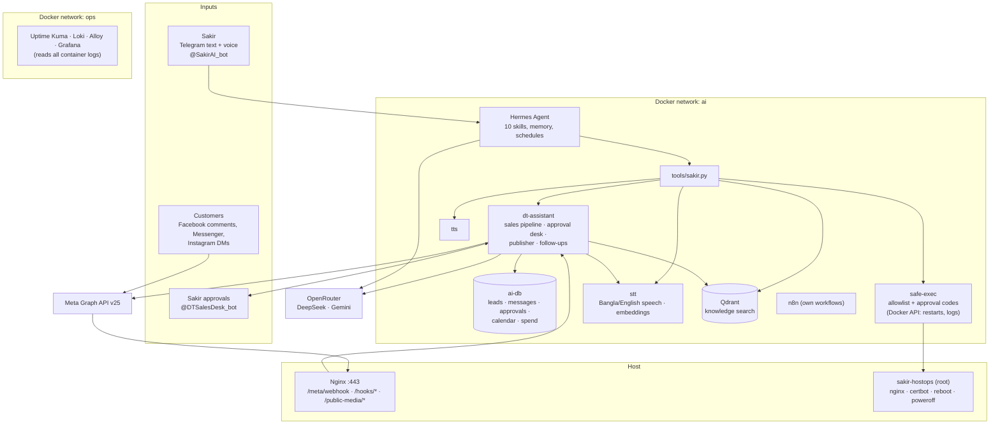
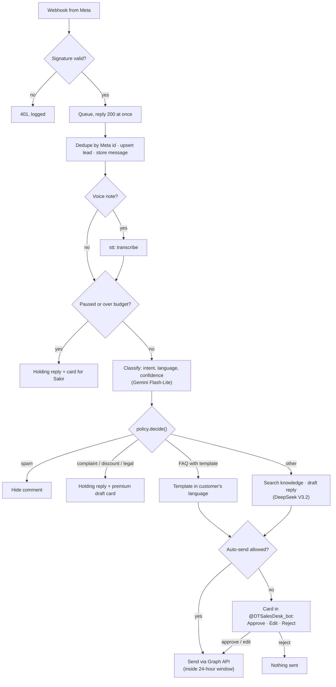
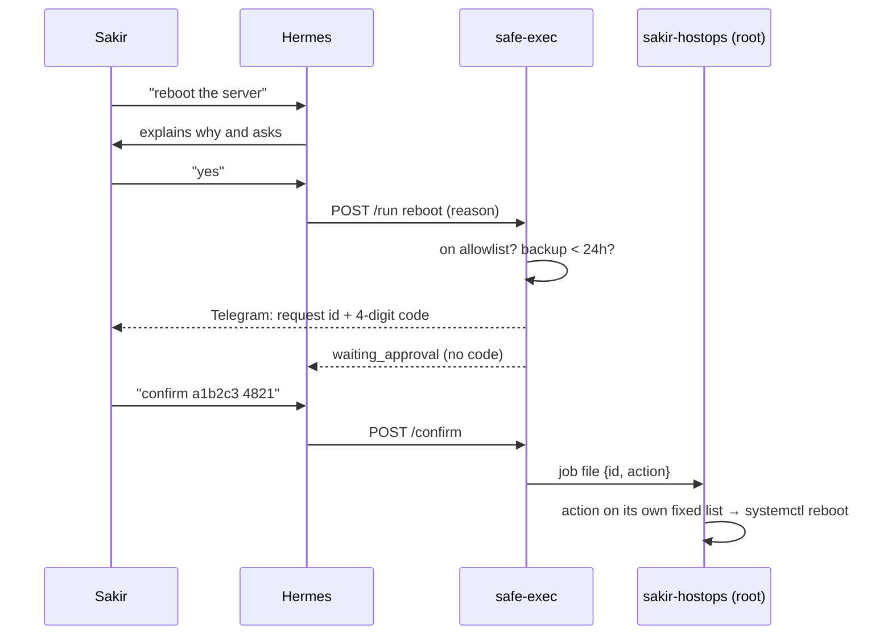

# Architecture (as built)

This describes the system the code in this repo actually installs. The original
plan is in [`Sakir AI 001 — Build Blueprint.md`](../Sakir%20AI%20001%20%E2%80%94%20Build%20Blueprint.md);
where the two differ, this file is correct and [DECISIONS.md](DECISIONS.md) says why.

## At a glance

Sakir talks to Hermes. Customers talk to dt-assistant, and Sakir approves its
replies in a second bot. Neither of them can touch the server directly: every
server action is a named action in safe-exec.

## Components

| Component | Code | Role | Talks to |
| --- | --- | --- | --- |
| Hermes Agent | upstream image, skills in `hermes/skills/` | Sakir's private assistant: briefs, content, career, branding, learning, DevOps questions, voice notes | OpenRouter, `tools/sakir.py` |
| `tools/sakir.py` | `tools/sakir.py` | The single command every skill uses (server, sales, content, kb, voice) | safe-exec, dt-assistant, stt, tts, Qdrant |
| dt-assistant | `services/dt-assistant/` | Facebook/Instagram sales replies, approval bot, content publisher, follow-ups, daily metrics, internal API | Meta, OpenRouter, Telegram, ai-db, stt, Qdrant |
| ai-db | Postgres 16, schema in `services/dt-assistant/app/schema.sql` | Leads, messages, approvals, content calendar, spend, settings, metrics | — |
| safe-exec | `services/safe-exec/` | Allowlisted server actions; risky ones need a code sent to Sakir | Docker socket, host job queue, Telegram |
| sakir-hostops | `hostops/sakir-hostops` + `systemd/` | Root runner for host actions (Nginx, SSL, reboot, power off) | host |
| stt | `services/stt/` | Bangla (BanglaSpeech2Text) and English (faster-whisper) transcription; multilingual-e5 embeddings | — |
| tts | `services/tts/` | Spoken replies (Bangla/English) | Microsoft Edge voices |
| Qdrant + indexer | `services/indexer/` | Search over `knowledge/` (collections `restora`, `me`, `ops`) | stt |
| n8n | upstream image | Free for Sakir's own no-code automations; not used by the core | — |
| Monitoring | `config/loki.yaml`, `config/alloy.config`, Grafana provisioning | Logs (30 days), uptime, dashboards | Docker socket (read-only) |
| settings-ui | `services/settings-ui/` | Dashboard (`/`: flow diagram, container health, sales pipeline, spend, backup age) + web edit form (`/settings`: tokens, keys, budget, autonomy, retention; "Apply" recreates the affected container) | Docker socket (read/write), the whole project directory, dt-assistant's `/internal/*` API |

## Customer message flow

Rules that never change without editing code (`app/policy.py`):
- `price`, `discount`, `complaint`, `order`, `legal` and `other` are never sent automatically.
- A voice note that could not be transcribed is never answered automatically.
- Messenger/Instagram replies are only sent inside Meta's 24-hour window (5-minute margin).
- At most one holding reply per lead every 12 hours.
- A double tap on Approve sends once (the approval row is claimed atomically).

## Risky server action flow

Hermes never sees the code, so a prompt injection cannot approve anything.
Three wrong codes or 10 minutes cancel the request; a safe-exec restart
cancels all pending requests.

## Networks and exposure

| Exposure | What |
| --- | --- |
| Internet (UFW) | 22 (SSH, key-only), 80/443 (Nginx) |
| Public paths | `/meta/webhook` → dt-assistant, `/hooks/*` → n8n webhooks, `/public-media/*` → images for Instagram |
| 127.0.0.1 only | dt-assistant 8081, n8n 5678, Grafana 3000, Uptime Kuma 3001, settings-ui 8090 (reach via Tailscale or SSH tunnel) |
| Docker socket | safe-exec (read/write, allowlisted actions only), Alloy (read-only, logs), settings-ui (read/write, password-protected — see D-015) |
| DT products (future) | run natively on the host (Nginx → PHP-FPM/Node, MySQL/PostgreSQL, Redis via systemd), not in Docker — see D-013 |

## Resource limits

| Service | CPU | RAM |
| --- | --- | --- |
| hermes | 1.5 | 3 GB |
| dt-assistant | 1 | 768 MB |
| ai-db | 1 | 2 GB |
| n8n + n8n-db | 1.5 | 3 GB |
| qdrant | 0.5 | 2 GB |
| stt | 2 | 5 GB |
| tts, safe-exec | 0.5 | 512 MB |
| monitoring (4 services) | 1.25 | 2.4 GB |
| **Total cap** | **~9.25** | **~19 GB** |

That leaves about 3 vCPU and 29 GB of the 12 vCPU / 48 GB server for DT products.

## Data

| Data | Where | Backed up |
| --- | --- | --- |
| Leads, messages, approvals, calendar, spend | `data/ai-db` | nightly SQL dump |
| n8n workflows and credentials | `data/n8n-db`, `data/n8n` | nightly SQL dump |
| Hermes memory, skills, sessions, config | `data/hermes` | nightly (files) |
| Knowledge (source of truth) | `knowledge/` (Git) | nightly (files) + your Git remote |
| Search index | `data/qdrant` | not needed (rebuilt by `sakir-ai reindex`) |
| Speech models | `data/models` | not needed (re-downloaded) |
| Secrets | `secrets/`, `.env` | nightly (inside the encrypted archive) |
| Generated files | `outbox/` | not backed up — copy what you keep |

## Schedules (Asia/Dhaka)

| Time | Job | Runs in |
| --- | --- | --- |
| every 1 min | uptime checks | Uptime Kuma |
| every 1 min | publish due posts | dt-assistant |
| every 10 min | stale-draft warnings | dt-assistant |
| every 30 min | follow-up drafts | dt-assistant |
| 02:30 | knowledge re-index | systemd `sakir-index.timer` |
| 03:00 | encrypted backup | systemd `sakir-backup.timer` |
| 08:30 / 21:30 | morning brief / evening summary | Hermes schedule (set after install) |
| every 5 min | heartbeat to the outside monitor (if configured) | systemd `sakir-heartbeat.timer` |
| daily | delete messages/drafts/dead leads past retention | dt-assistant |
| 21:00 | daily metrics snapshot | dt-assistant |
| Mon 10:00 | job scan | Hermes schedule |
| Tue, Fri 11:00 | LinkedIn drafts | Hermes schedule |
| Sun 09:00 | learning plan | Hermes schedule |
