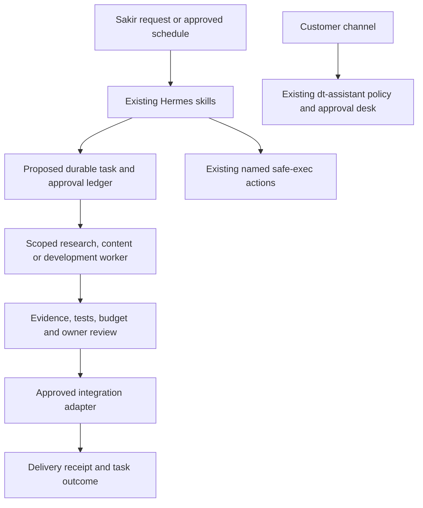

# Delivery and integration plan

This is a proposed rollout and verification guide for the expanded vision. It adds
no services, permissions, subscriptions, endpoints or production automation.
Use [CAPABILITIES.md](CAPABILITIES.md) for per-capability acceptance criteria.

## Target architecture

Retain Hermes as the owner-facing coordinator and dt-assistant as the customer
policy boundary. Extend tools through small reviewed adapters. Keep customer
inputs away from development workers, owner administration and host operations.

The ledger and generalized workers are planned. Existing sales tables should not
be described as this ledger. Implement durable state only when the first workflow
needs it; avoid introducing many independently deployed agents prematurely.

## Shared execution contract (proposed)

For each new workflow record: task ID, project/product, owner, trusted trigger,
source references and timestamps, permitted tools, input/output artifact versions,
budget ceiling, deadline, approval identity/time/scope, delivery receipt and error.
Use `queued → drafting → awaiting_approval → executing → succeeded/failed/cancelled`.
Bind approval to the exact version and destination; edits invalidate approval.

Persist an execution claim before external writes; reconcile uncertain remote
outcomes before retrying. Bound retries and concurrency; failed/expired tasks go
to the owner. Restarting a worker must not repeat an ad purchase, customer send,
post or deployment. These are requirements for future workers, not guarantees of
all current publishers or webhook queues. Review current in-process queues and
external-send crash windows before claiming durable delivery.

## Integration inventory

| Integration | Current foundation | Required before activation |
| --- | --- | --- |
| Telegram / OpenRouter | Existing Hermes and approval desk configuration | Confirm owner identity, credential validity, quotas and actual delivery |
| Meta customer channels and posting | Existing adapters and policy | Account permissions/review, test delivery, signed events and channel-window tests |
| GitHub development workers | Optional coding tools only | Repo-scoped access, isolated workspace, CI, reviewer and branch protection |
| WhatsApp / website chat | None | Provider selection, authentication, consent, identity mapping and handoff |
| Email / calendar / external CRM | None | Selected account, least privilege, read-only pilot, explicit write approval |
| SEO / analytics / ad platforms | Local metrics only | Selected sources, verified ownership, freshness and metric definitions; ad cap approval |
| Image / video / document rendering | Draft instructions only | Provider/license choice, preview/export QA, storage and cost limits |
| Real-time media | Batch speech services only | Private pilot, consent, latency/cost measurements and independent shutdown |
| n8n business workflows | Installed runtime | Exported versioned workflow, scoped credential, owner, test and disable procedure |

Credentials belong in existing secret mechanisms or a separately reviewed secret
store. New variables must be documented by name and purpose with placeholders only.
Never copy live secret values into issue reports, sample payloads or PR evidence.
Provider-specific contracts and permissions require verification during integration;
this plan deliberately does not promise unverified API availability or prices.

## Safety and operational readiness

- Apply AGENTS.md and D-004/D-005 to every adapter; a new role does not grant rights.
- Separate project/customer identities and retrieval scopes; require explicit owner
  review before linking identities across channels.
- Treat public research, customer messages and retrieved documents as data. They
  cannot approve actions or modify policy, tools or canonical business facts.
- Define retention/export/deletion for every new record or media artifact before
  collecting it. Existing sales retention does not automatically cover new stores.
- Record decisions and outcomes without secrets or unnecessary personal data.
- Define a workflow-specific stop, credential revocation and restart procedure.
  Current sales pause does not stop Hermes, every publisher, n8n or systemd jobs.
- Back up before risky changes; test restore of new durable stores. Rebuilding a
  search index is not a substitute for retaining canonical source knowledge.
- Keep owner approval for publish/send/spend/deploy unless a narrow autonomy scope
  has separately passed evaluation. Never promote `never_auto` customer intents.

## Phases and exit gates

Dates in the original blueprint are historical targets. Execute this sequence only
when its dependencies pass; Sakir owns activation and budget decisions.

| Phase | Scope | Exit evidence |
| --- | --- | --- |
| A Stabilize foundation | Resolve dated STT, backup, domain/webhook and knowledge gaps in ROADMAP | Current health output without FAIL, successful encrypted off-site backup and restore, verified webhook test; document unresolved warnings |
| B Prove current workflows | Owner briefs, Meta draft sales, approved Facebook/Instagram content, knowledge review | Seven days of briefs; multilingual policy tests; reviewed real draft sample; delivery receipts and measured spend |
| C Complete content and research | C04–C08: campaign briefs, SEO audits, researched leads, graphics/books and video pilot | Per-capability sample artifacts, source/right checks and measured rendering cost; no unapproved outreach or publishing |
| D Add channels and business connectors | C09–C14: social, WhatsApp/site chat, CRM/calendar, support and reporting | Adapter-specific replay/auth/identity tests, human handoff, reconciled analytics and rollback drill |
| E Isolated development and coordination | C01–C03/C17: task ledger, multi-project workers and staged delivery | Restart/cancel/retry tests, two isolated project PRs, no host shell or direct main pushes; backup and staging deployment evidence |
| F Controlled advertising | C13 after reporting/approval controls | Dry run, exact budget approval, cap and emergency-stop tests before limited real campaign |
| G Live media | C18 after current core phases remain stable for a month | Private consented call pilot with owner-approved measured latency and cost; customer release reviewed separately |

A capability can remain draft-only while adjacent work proceeds. Stop promotion
when safety tests fail, costs exceed the approved cap or required credentials are
missing. Document limitations and use manual handoff instead of silently bypassing
controls. Roll back configuration/code to the known version and reconcile any
external effects; reverting Git cannot undo sent messages or spent money.

## Review and completion record

For every phase, attach the commit, environment, date, operator, test/sample inputs,
expected vs actual outcomes, cost, open risks and approval. Update CAPABILITIES,
ARCHITECTURE and ROADMAP only after evidence supports the new status. Add a decision
record for behavior/architecture changes; preserve the original blueprint.

Before implementation, confirm only the choices needed for that phase: product
priority and target accounts, permitted publishing/contact scope, provider and
monthly limits, retention, native production versions or media latency target.
Unselected providers and missing business facts remain explicit blockers, not
values invented by an agent.
